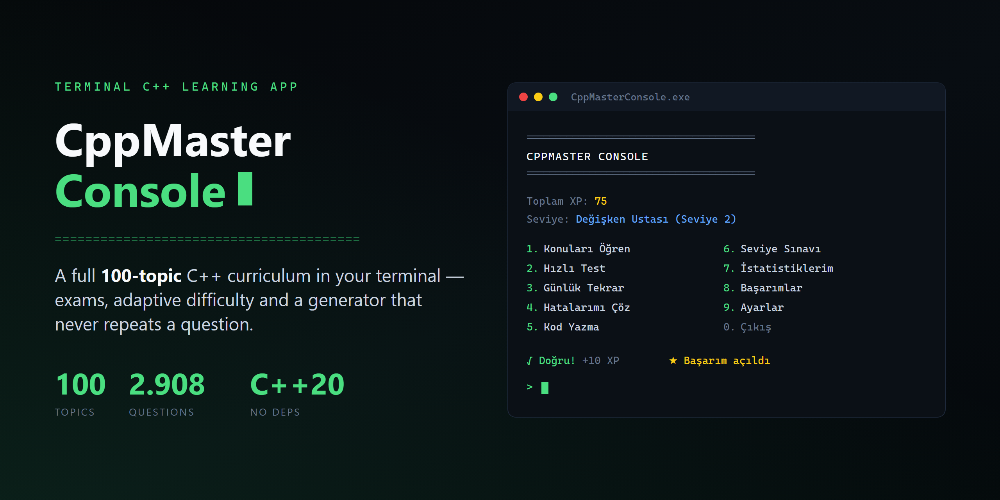

# CppMaster Console

[](https://github.com/Layellie/cppmaster-console/actions/workflows/ci.yml)
[](LICENSE)
[](https://en.cppreference.com/w/cpp/20)

**Language / Dil: [English](#english) · [Türkçe](#türkçe)**

> **Note:** The application's own interface is **Turkish only**. This README is
> available in English and Turkish, while the app itself is not translated.
>
> **Not:** Uygulamanın arayüzü **yalnızca Türkçe**'dir. Bu README iki dilde
> hazırlandı, ancak uygulamanın kendisi çevrilmedi.

---

<a id="english"></a>

# English

CppMaster Console is a terminal app for learning C++ with a **Turkish
interface**. It includes 100 lessons, 2,908 handwritten questions, hints,
sequential topic locking, adaptive difficulty, 25 code writing exercises,
section exams, a general final exam, and 17 runtime question generators built
to avoid repeating the same question.

## Quick install (Windows)

You do not need a compiler or CMake. One PowerShell command downloads the
prebuilt standalone `.exe` and starts it:

```powershell
irm https://raw.githubusercontent.com/Layellie/cppmaster-console/master/install.ps1 | iex
```

This downloads the latest build from `master` into
`%LOCALAPPDATA%\CppMasterConsole` and launches it. Your progress stays in that
same folder between runs. Because the executable links the MSVC runtime
statically, it runs without the Visual C++ Redistributable installed; its only
runtime dependency is `KERNEL32.dll`.

If you prefer not to pipe a script into PowerShell, read
[`install.ps1`](install.ps1) first (it is short), or build from source below.
See [SECURITY.md](SECURITY.md) for the trust details.

## What it looks like

```
=======================================================================
CPPMASTER CONSOLE
=======================================================================

Toplam XP: 75
Seviye: Değişken Ustası (Seviye 2)

1. Konuları Öğren   5. Kod Yazma Alıştırmaları    9. Ayarlar
2. Hızlı Test       6. Seviye Sınavı             10. İlerlemeyi Sıfırla
3. Günlük Tekrar    7. İstatistiklerim            0. Çıkış
4. Hatalarımı Çöz   8. Başarımlar

Seçimin:
```

A slice of a topic quiz, where correct answers print in green, wrong ones in
red, and achievements in yellow:

```
Konu testi başlıyor (8 soru).

cout, kullanıcıdan klavyeden veri okumak için kullanılır.
1. Doğru
2. Yanlış
Cevabın: 2
Doğru! (+5 XP)

Yeni başarım kazandın: İlk Adım
İlk sorunu çözdün.
```

During a quiz, you can type `ipucu` (hint), `konu` (lesson), `ornek` (example),
`gec` (skip), or `cikis` (exit). Each hint level takes 25% off the XP awarded
for that question.

## Features

The curriculum covers 100 topics across 10 sections. Every topic ships with a
full lesson: explanation, syntax, example code, line by line notes, and common
mistakes. Practice draws from 2,908 handwritten questions spanning all 11
question types. In "Hızlı Test" (Quick Test), 17 runtime generators also create
fresh questions on the fly through a 4 stage escalation pipeline (Normal →
Expanded Parameters → Structural Variation → Cross Topic) so the same question
does not come back.

Topics open in order. You finish one topic before moving to the next, and
locked topics stay hidden from the list. On first launch, your chosen starting
level sets the initial range: beginner starts at topic 1, intermediate opens
topics 1 to 20, and experienced opens topics 1 to 40. You can turn topic
locking off completely in Settings.

Each section has a 20 question exam, followed by a 100 question general final
exam with a 70% pass mark gated on how much of the curriculum you finished.
During quizzes, consecutive right answers raise the question difficulty, while
consecutive misses bring up extra help automatically. Outside quizzes, there
are 25 handwritten code writing exercises split across Beginner, Intermediate,
and Advanced tiers, with completed exercises marked in the list.

Progress runs on a 10 level XP system with achievements you earn as you go,
along with dedicated mistake review and daily review modes. Settings let you
toggle coloured output and audio alerts, and change the question counts for
Quick Test and topic quizzes. All user data (progress, mistakes, achievements,
generated question history, and settings) is stored in a local `data/` folder
that git ignores.

## Building from source

### Requirements

- CMake ≥ 3.20
- A C++20 compiler: MSVC 2022+, GCC 11+, or Clang 14+ (all three run in CI,
  see [Platform support](#platform-support))
- No external libraries; the app and its test runner use only the C++ standard
  library

### Build

With CMake presets:

```bash
cmake --preset default         # configure
cmake --build --preset default # build
ctest --preset default         # test
```

Or with plain CMake commands:

```bash
cmake -B build
cmake --build build
```

For a standalone Release build:

```bash
cmake --preset release && cmake --build --preset release
```

On MSVC, `CMAKE_MSVC_RUNTIME_LIBRARY` in `CMakeLists.txt` links the runtime
statically, so the resulting `.exe` works without the Visual C++
Redistributable.

### Running

With MSVC or another generator that writes per configuration subfolders:

```bash
./build/Debug/CppMasterConsole.exe
```

With Makefiles or Ninja:

```bash
./build/CppMasterConsole
```

### Running the tests

```bash
ctest --test-dir build --output-on-failure
```

Or run the test binary directly:

```bash
./build/Debug/CppMasterConsoleTests.exe
```

Tests use a small macro based runner (`TEST_CASE`) in `tests/TestRunner.h` with
no external dependencies. A separate target, `CppMasterConsoleStressTests`,
runs the question generation engine through 10,000+ iterations. It stays out of
`ctest` because Debug runs take about 10 to 15 seconds (a few seconds in
Release), which would slow down quick local runs. Run it directly when needed:

```bash
./build/Debug/CppMasterConsoleStressTests.exe
```

### Automated builds and releases

`.github/workflows/release.yml` builds a Release binary on every push to
`master`, runs both the unit tests and the stress suite, and publishes the
standalone `.exe` to the repository's "latest" GitHub Release. That is the file
`install.ps1` downloads.

## Project layout

```
src/                Application source (CppMasterConsoleLib static library + main.cpp)
src/generators/     Runtime question generators (17, each in its own .h/.cpp pair)
tests/              Unit tests (CppMasterConsoleTests target)
tests/Generators/   One test file per generator
tests/StressTests/  10,000+ iteration generation stress tests (separate target)
data/               Per user progress, statistics, and settings files (not tracked)
docs/superpowers/   Design specs (specs/), implementation plans (plans/), roadmap.md
.github/workflows/  CI for build, tests, static analysis, and GitHub Release uploads
install.ps1         Single command Windows install and launch script
```

## Architecture notes

The core piece of the codebase is the runtime question generation system, built
to give unlimited practice without repeating questions:

- Each generator under `src/generators/` covers a single topic and implements
  `IQuestionGenerator`.
- Every generated question carries two signatures: an **exact** signature (all
  chosen parameters, including variable names) and a **semantic** signature
  (ignoring cosmetic differences). Both are hashed with FNV-1a and stored in
  `QuestionHistory`, so swapping a variable name does not count as a new
  question.
- `QuestionGenerationEngine` escalates through 4 stages: Normal → Expanded
  Parameters → Structural Variation, and if those run dry, a Cross Topic
  fallback that tries other generators ordered by success rate. Each stage gets
  20 attempts.
- `GeneratorScoring` tracks each generator's success rate, and
  `GeneratedQuestionValidator` checks that every generated question is
  structurally valid before it reaches the user.

The 10,000 iteration stress test in `tests/StressTests/` checks this pipeline
for zero duplicates, zero invalid questions, and 100% generation success.

Other design choices:

- Business logic (`QuizEngine`, `LevelSystem`, `TopicLock`,
  `AdaptiveDifficulty`) is kept separate from console I/O and interactive
  screens (`Application`, `QuizSession`, `ExamSession`, `CodeExerciseSession`,
  `SettingsScreen`), so logic classes are straightforward to test in isolation.
- Persistent files are plain text. Saves go through a temporary file and atomic
  rename (`src/AtomicFileWrite.cpp`) so an interrupted write does not truncate
  existing progress. On load, corrupted files are backed up
  (`*_corrupted_backup.txt`) and reset to defaults.
- Lesson and question data is compiled into the binary
  (`LessonContentSectionN.cpp`, `QuestionsSectionN.cpp`) so the Windows release
  ships as one `.exe` with no external asset folder.

## About test coverage

All pure logic, persistence, and `ConsoleUI` I/O behaviour (redirected streams,
colour formatting, screen clearing, EOF handling, and Turkish UTF-8 input) are
covered by 259 unit tests in `CppMasterConsoleTests`. Interactive `Application`
menus and full session flows are verified manually with scripted input
scenarios, documented in the phase plans under `docs/superpowers/plans/`.

## Platform support

Every push and pull request runs four CI jobs:

| Job | Compiler / tool | Status |
|---|---|---|
| Windows | MSVC (`/W4 /permissive- /utf-8`) | Pass: build, unit tests, stress tests, **0 warnings** |
| Linux | GCC (`-Wall -Wextra -Wpedantic -Wconversion -Wshadow`) | Pass: build, unit tests, stress tests, **0 warnings** |
| Linux | Clang (same flags) | Pass: build, unit tests, stress tests, **0 warnings** |
| Static analysis | clang-tidy | Pass: blocking (`-warnings-as-errors='*'`) |

Windows specific code is isolated behind `#ifdef _WIN32` in `src/ConsoleUI.cpp`
(plus the atomic replace call in `src/AtomicFileWrite.cpp`). `ConsoleUI` sets
and restores the UTF-8 console code page, enables
`ENABLE_VIRTUAL_TERMINAL_PROCESSING` for ANSI colour and screen clearing with a
Win32 Console API fallback, and reads interactive Turkish UTF-8 input through
`ReadConsoleW`. If colour mode cannot be enabled, output falls back to plain
text instead of printing raw escape codes.

macOS is not tested in CI, though it follows the same code paths as Linux with
Clang.

## Contributing

Contributions are welcome for code, lesson content, or question fixes. See
[CONTRIBUTING.md](CONTRIBUTING.md) to get started, and
[SECURITY.md](SECURITY.md) for security reports.

## Changelog

See [CHANGELOG.md](CHANGELOG.md) for release notes.

## License

[MIT](LICENSE), Copyright (c) 2026 Samet Kaşmer.

<div align="right"><a href="#cppmaster-console">↑ Back to top</a></div>

---

<a id="türkçe"></a>
<a id="turkce"></a>

# Türkçe

CppMaster Console, C++ öğrenmek için yazılmış terminal tabanlı, **Türkçe** bir
alıştırma ve sınav uygulaması. İçinde 100 konuluk müfredat, 2.908 elle yazılmış
soru, ipucu, sıralı konu kilidi, adaptif zorluk, 25 kod yazma alıştırması,
bölüm sınavları, genel final sınavı ve aynı soruyu tekrar etmeden çalışma
zamanında soru üreten 17 üretici var.

## Hızlı kurulum (Windows)

Derleyici veya CMake kurmana gerek yok. Tek bir PowerShell komutu önceden
derlenmiş tek dosya `.exe`'yi indirip çalıştırır:

```powershell
irm https://raw.githubusercontent.com/Layellie/cppmaster-console/master/install.ps1 | iex
```

Bu komut `master` dalındaki son derlemeyi `%LOCALAPPDATA%\CppMasterConsole`
klasörüne indirip başlatır. İlerlemen sonraki çalıştırmalarda aynı klasörde
kalır. `.exe` dosyası MSVC çalışma zamanına statik bağlandığı için Visual C++
Redistributable kurulu olmasa da çalışır; tek bağımlılığı `KERNEL32.dll`'dir.

Bir script'i doğrudan PowerShell'e aktarmak istemiyorsan önce
[`install.ps1`](install.ps1) dosyasını okuyabilir (kısadır) ya da aşağıdan
kaynaktan derleyebilirsin. Güven detayları için [SECURITY.md](SECURITY.md)
dosyasına bakabilirsin.

## Nasıl görünüyor?

```
=======================================================================
CPPMASTER CONSOLE
=======================================================================

Toplam XP: 75
Seviye: Değişken Ustası (Seviye 2)

1. Konuları Öğren   5. Kod Yazma Alıştırmaları    9. Ayarlar
2. Hızlı Test       6. Seviye Sınavı             10. İlerlemeyi Sıfırla
3. Günlük Tekrar    7. İstatistiklerim            0. Çıkış
4. Hatalarımı Çöz   8. Başarımlar

Seçimin:
```

Bir konu testinden kesit (doğru cevap yeşil, yanlış kırmızı, başarımlar sarı
renkte basılır):

```
Konu testi başlıyor (8 soru).

cout, kullanıcıdan klavyeden veri okumak için kullanılır.
1. Doğru
2. Yanlış
Cevabın: 2
Doğru! (+5 XP)

Yeni başarım kazandın: İlk Adım
İlk sorunu çözdün.
```

Soru çözerken `ipucu`, `konu`, `ornek`, `gec` ve `cikis` komutları
kullanılabilir. Her ipucu seviyesi o sorudan gelecek XP'yi %25 azaltır.

## Kapsam

Müfredat 10 bölüm ve 100 konudan oluşuyor. Her konuda tam ders metni var:
açıklama, sözdizimi, örnek kod, satır satır inceleme ve yaygın hatalar. Soru
havuzunda 11 soru tipinin tamamını kapsayan 2.908 elle yazılmış soru bulunuyor.
"Hızlı Test" modunda buna ek olarak 17 üretici, 4 aşamalı bir üretim hattıyla
(Normal → Genişletilmiş Parametreler → Yapısal Varyasyon → Çapraz Konu) çalışma
zamanında tekrar etmeyen yeni sorular üretiyor.

Konular kilitli gelir ve sırayla açılır. Bir konuyu bitirmeden sonrakine
geçilemez ve kilitli konular listede görünmez. İlk açılışta seçtiğin seviye
başlangıç aralığını belirler: yeni başlayan yalnızca 1. konuyla başlar, orta
seviye 1 ile 20 arasını, deneyimli ise 1 ile 40 arasını açar. İsteyen kilit
sistemini Ayarlar'dan tamamen kapatabilir.

Her bölüm sonunda 20 soruluk bir sınav, müfredat ilerledikçe açılan 100 soruluk
bir genel final sınavı var (%70 geçme notu). Test sırasında art arda doğru
cevaplar zorluğu yükseltir, art arda yanlışlar otomatik ek yardım açar. Testler
dışında Başlangıç, Orta ve İleri seviyelerine ayrılmış 25 elle yazılmış kod
yazma alıştırması bulunur ve bitenler listede işaretlenir.

İlerleme 10 seviyelik XP sistemi, kazanılan başarımlar, yanlış tekrarı ve
günlük tekrar akışlarıyla takip edilir. Renkli çıktı, sesli uyarı, Hızlı Test
ve konu testi soru sayıları Ayarlar'dan değiştirilebilir. İlerleme, yanlış
kayıtları, başarımlar, üretilen soru geçmişi ve ayarlar git tarafından takip
edilmeyen `data/` klasöründe tutulur.

## Geliştirici olarak derleme

### Gereksinimler

- CMake ≥ 3.20
- C++20 destekleyen bir derleyici: MSVC 2022+, GCC 11+ veya Clang 14+ (üçü de
  CI'da doğrulanıyor, bkz. [Platform desteği](#platform-desteği))
- Harici kütüphane yok; uygulama ve test çalıştırıcı yalnızca C++ standart
  kütüphanesini kullanır

### Derleme

CMake preset'leriyle:

```bash
cmake --preset default         # yapılandır
cmake --build --preset default # derle
ctest --preset default         # test et
```

Ya da klasik CMake komutlarıyla:

```bash
cmake -B build
cmake --build build
```

Tek dosya olarak dağıtılabilir Release derlemesi için:

```bash
cmake --preset release && cmake --build --preset release
```

MSVC'de `CMakeLists.txt` içindeki `CMAKE_MSVC_RUNTIME_LIBRARY` ayarı çalışma
zamanını statik bağlar; çıkan `.exe` Visual C++ Redistributable kurulu olmayan
bir makinede de çalışır.

### Çalıştırma

Windows/MSVC gibi yapılandırmaya göre alt klasör oluşturan generator'larda:

```bash
./build/Debug/CppMasterConsole.exe
```

Makefiles veya Ninja ile:

```bash
./build/CppMasterConsole
```

### Testleri çalıştırma

```bash
ctest --test-dir build --output-on-failure
```

Veya test dosyasını doğrudan çalıştır:

```bash
./build/Debug/CppMasterConsoleTests.exe
```

Testler `tests/TestRunner.h` içindeki makro tabanlı (`TEST_CASE`) küçük bir
çalıştırıcı kullanır ve dış bağımlılığı yoktur. Ayrı bir hedef olan
`CppMasterConsoleStressTests`, soru üretim motorunu 10.000'den fazla
iterasyonla sınar. Debug derlemesinde yaklaşık 10 ila 15 saniye sürdüğü için
(Release'de birkaç saniye) günlük test döngüsünü yavaşlatmaması adına `ctest`
dışında bırakılmıştır; gerektiğinde elle çalıştırılır:

```bash
./build/Debug/CppMasterConsoleStressTests.exe
```

### Otomatik derleme ve dağıtım

`.github/workflows/release.yml`, `master`'a her push'ta Release derlemesi alır,
birim ve stres testlerini çalıştırır, ardından tek dosya `.exe`'yi repo'nun
"latest" GitHub Release'ine yükler. `install.ps1` doğrudan bu dosyayı indirir.

## Proje yapısı

```
src/                Uygulama kaynak kodu (CppMasterConsoleLib statik kütüphanesi + main.cpp)
src/generators/     Çalışma zamanı soru üreticileri (17 adet, her biri kendi .h/.cpp çiftinde)
tests/              Birim testleri (CppMasterConsoleTests hedefi)
tests/Generators/   Her üretici için ayrı test dosyası
tests/StressTests/  10.000+ iterasyonluk üretim stres testleri (ayrı hedef)
data/               Kullanıcıya özel ilerleme, istatistik ve ayar dosyaları (git'e dahil değil)
docs/superpowers/   Tasarım dokümanları (specs/), uygulama planları (plans/), roadmap.md
.github/workflows/  Derleme, test, statik analiz ve GitHub Release otomasyonu
install.ps1         Tek komutluk Windows kurulum ve başlatma script'i
```

## Mimari notlar

Kod tabanının ana mekanizması, aynı soruyu tekrarlamadan sınırsız pratik
sağlamak için yazılmış çalışma zamanı soru üretim sistemi:

- `src/generators/` altındaki her üretici tek bir konudan sorumludur ve
  `IQuestionGenerator` arayüzünü uygular.
- Üretilen her soru iki imza taşır: **exact** (değişken adı dahil tüm seçilen
  parametreler) ve **semantic** (kozmetik farklar hariç). İkisi de FNV-1a ile
  hash'lenip `QuestionHistory` içinde saklanır; böylece yalnızca değişken adı
  değişen bir soru yeni sayılmaz.
- `QuestionGenerationEngine` 4 aşamalı bir tırmanma izler: Normal →
  Genişletilmiş Parametreler → Yapısal Varyasyon; bunlar tükenirse diğer
  üreticileri başarı oranına göre deneyen Çapraz Konu yedeğine geçer. Her
  aşamanın 20 deneme hakkı vardır.
- `GeneratorScoring` her üreticinin başarı oranını tutar;
  `GeneratedQuestionValidator` ise üretilen sorunun yapısal geçerliliğini
  kullanıcıya çıkmadan önce kontrol eder.

`tests/StressTests/` içindeki 10.000 iterasyonluk stres testi bu hattı sıfır
tekrar, sıfır geçersiz soru ve %100 üretim başarısı için doğrular.

Diğer tasarım kararları:

- İş mantığı (`QuizEngine`, `LevelSystem`, `TopicLock`, `AdaptiveDifficulty`)
  konsol G/Ç'sinden ve etkileşimli ekranlardan (`Application`, `QuizSession`,
  `ExamSession`, `CodeExerciseSession`, `SettingsScreen`) ayrı tutulur; bu
  sayede mantık sınıfları tek başına test edilebilir.
- Kalıcı veriler düz metin dosyalarında saklanır. Yazma işlemleri geçici dosya
  ve atomik yeniden adlandırma (`src/AtomicFileWrite.cpp`) üzerinden yapılır;
  yazma yarıda kesilirse mevcut ilerleme bozulmaz. Yükleme sırasında bozuk
  dosya tespit edilirse yedeklenir (`*_corrupted_backup.txt`) ve varsayılanlara
  dönülür.
- Ders ve soru içerikleri doğrudan koda gömülüdür (`LessonContentSectionN.cpp`,
  `QuestionsSectionN.cpp`). Bu sayede Windows sürümü harici veri klasörü
  olmadan tek `.exe` olarak dağıtılır.

## Test kapsamı hakkında

`src/` altındaki saf iş mantığı, dosya kalıcılığı ve `ConsoleUI` G/Ç
davranışları (yönlendirilmiş akışlar, renkli biçimlendirme, ekran temizleme,
EOF yönetimi ve Türkçe UTF-8 girdisi) `CppMasterConsoleTests` içindeki 259
birim testiyle kapsanır. Etkileşimli `Application` menüleri ve uçtan uca oturum
akışları, `docs/superpowers/plans/` altındaki faz planlarında kayıtlı elle
hazırlanmış giriş senaryolarıyla doğrulanır.

## Platform desteği

Her push ve pull request'te CI'da dört iş çalışır:

| İş | Derleyici / araç | Durum |
|---|---|---|
| Windows | MSVC (`/W4 /permissive- /utf-8`) | Geçti: derleme, birim ve stres testleri, **0 uyarı** |
| Linux | GCC (`-Wall -Wextra -Wpedantic -Wconversion -Wshadow`) | Geçti: derleme, birim ve stres testleri, **0 uyarı** |
| Linux | Clang (aynı bayraklar) | Geçti: derleme, birim ve stres testleri, **0 uyarı** |
| Statik analiz | clang-tidy | Geçti: bloklayıcı (`-warnings-as-errors='*'`) |

Windows'a özgü kodlar `src/ConsoleUI.cpp` içinde `#ifdef _WIN32` arkasına
alınmıştır (ek olarak `src/AtomicFileWrite.cpp` içindeki atomik dosya
değiştirme çağrısı). `ConsoleUI`, UTF-8 konsol kod sayfasını ayarlayıp çıkışta
eski haline döndürür, ANSI renkleri ve ekran temizleme için
`ENABLE_VIRTUAL_TERMINAL_PROCESSING` modunu açar (açılamazsa Win32 Console API
yedeğine geçer) ve etkileşimli Türkçe UTF-8 girdisini `ReadConsoleW` ile okur.
Renk desteği açılamazsa çıktı bozuk kaçış dizileri basmak yerine düz metne
düşer.

macOS ayrıca test edilmiyor, ancak Linux/Clang ile aynı kod yollarını
kullandığından çalışması bekleniyor.

## Katkıda bulunma

Kod, ders içeriği veya soru düzeltmeleri için katkılar memnuniyetle karşılanır.
Ayrıntılar için [CONTRIBUTING.md](CONTRIBUTING.md), güvenlik bildirimleri için
[SECURITY.md](SECURITY.md) dosyasına bakabilirsin.

## Sürüm geçmişi

Sürümler arası değişiklikler için [CHANGELOG.md](CHANGELOG.md).

## Lisans

[MIT](LICENSE), Copyright (c) 2026 Samet Kaşmer.

<div align="right"><a href="#cppmaster-console">↑ Başa dön</a></div>
